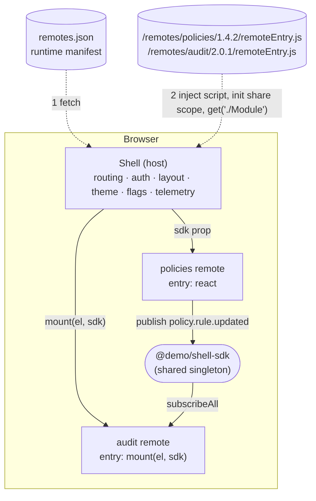

# React 18 + Module Federation demo

A small data-protection console built as micro-frontends. A **shell** (host) loads two independently built **remotes** at runtime with Webpack 5 Module Federation. They share one copy of React and talk to the shell only through a typed, versioned **shell SDK**.

**Live demo:** `https://<your-user>.github.io/react-mf-demo/` (after you enable Pages; see [Deploy](#deploy-to-github-pages))

| What | Where |
| --- | --- |
| Dynamic remotes from a runtime manifest (no hard-coded `remotes`) | [`apps/shell/src/federation/loadRemote.ts`](apps/shell/src/federation/loadRemote.ts) |
| Error boundary + Suspense per remote, retry, telemetry | [`apps/shell/src/federation/RemoteSlot.tsx`](apps/shell/src/federation/RemoteSlot.tsx) |
| Module contract validated at load (manifest, SDK semver, entry kind) | [`apps/shell/src/federation/contract.ts`](apps/shell/src/federation/contract.ts) |
| Shell SDK: auth/RBAC, nav, typed event bus, toasts, flags, store | [`packages/shell-sdk/src`](packages/shell-sdk/src) |
| `useSyncExternalStore` store and selector hook | [`packages/shell-sdk/src/store.ts`](packages/shell-sdk/src/store.ts) |
| Remote with a React entry (`useReducer`, `useTransition`) | [`apps/policies`](apps/policies) |
| Remote with a framework-agnostic `mount(el, sdk)` entry | [`apps/audit`](apps/audit) |
| React 18 lab: transitions, batching, StrictMode, lazy + retry, `useId` | [`apps/shell/src/lab`](apps/shell/src/lab) |
| Versioned release layout + generated runtime manifest | [`scripts/assemble.mjs`](scripts/assemble.mjs) |
| CI: lint, typecheck, unit + contract tests, size budget, Pages deploy | [`.github/workflows/ci.yml`](.github/workflows/ci.yml) |

Studying with it? Start with **[docs/STUDY_GUIDE.md](docs/STUDY_GUIDE.md)**.

## Architecture



Shared singletons: `react`, `react-dom`, `@demo/shell-sdk`. That's all; the shared list stays short on purpose.

## Run locally

Requires Node 20+ (CI uses 24).

```bash
npm install
```

```bash
npm run dev
```

That starts three dev servers: the shell on http://localhost:3000, policies on :3001 and audit on :3002. Each remote also runs **standalone** with a dev harness (open :3001 or :3002 directly).

Other scripts:

```bash
npm test            # Vitest + React Testing Library (unit + contract tests)
npm run typecheck   # tsc --noEmit, strict
npm run lint        # ESLint with react-hooks and jsx-a11y
npm run build       # production builds + assemble dist/ with versioned remotes
npm run preview     # serve dist/ at http://localhost:4173 with realistic cache headers
```

## Deploy to GitHub Pages

1. Create an empty GitHub repo and push this project to `main`.
2. In the repo, open **Settings → Pages** and set **Source** to **GitHub Actions**.
3. The `CI` workflow runs on every push. On `main` it uploads `dist/` and deploys it.

Every URL is relative (`publicPath: 'auto'`, a relative runtime manifest and `HashRouter`), so the same build works at `/` locally and at `/<repo>/` on Pages without configuration.

> GitHub Pages can't set per-file cache headers. On a real CDN, serve `remotes.json` and `remoteEntry.js` with `no-cache` and everything else as `immutable`; `npm run preview` does exactly that.

## Project layout

```
packages/shell-sdk/   platform contract: types, zod schemas, event bus, store, auth, tokens.css
apps/shell/           host: runtime manifest, remote loader, boundaries, layout, lab, inspector
apps/policies/        remote (React entry), version 1.4.2
apps/audit/           remote (mount entry), version 2.0.1
tools/                shared webpack factory (Module Federation config lives here)
scripts/              assemble dist/ with versioned paths; zero-dependency preview server
```
